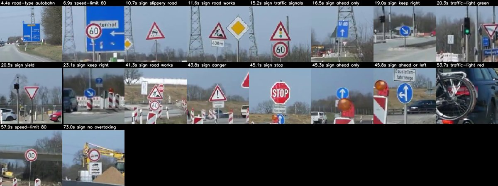

# roadsign-facts

Traffic lights, traffic signs and direction signs from dashcam video, turned
into facts for an expert system and sent as CAN messages. Built around a
video pipeline that runs all detectors on the same frame at the same time
and measures honestly what that gains.

Based on my research internship at the Chair of Computer Engineering,
TU Chemnitz (2021), topic *Facts generation from multiple image processing
algorithms*. This is a rewrite from scratch; the background and what changed
since the 2021 version is in [docs/background.md](docs/background.md).



## What it does

```
video ──► reader thread ──► frame ──┬─► traffic lights  ──┐
                                    ├─► traffic signs   ──┼─► facts ──► CAN frames ──► comprehension
                                    └─► direction signs ──┘   (voting)   (8 bytes)       (fact set,
                                                                                          CLIPS file)
```

- **Traffic lights**: lit red / green lamps found by colour, shape and the
  dark housing around them.
- **Traffic signs**: red and blue candidates, HOG + PCA + linear SVM trained
  on GTSRB (43 classes plus background), with a colour check of the inside.
  93.9 % accuracy on the GTSRB test set.
- **Direction signs**: blue panels (Autobahn) and yellow panels (other
  roads) with lettering, which give the road type.
- **Facts**: `speed-limit`, `traffic-light`, `road-type`, `sign`, asserted
  after 4 of 12 frames, each with its own rule for how long it holds.
  Written as JSON lines and CLIPS facts.
- **CAN**: one 8 byte frame per fact change, on a virtual bus or through
  python-can (socketcan, e.g. a PiCAN2 on a Raspberry Pi).
- **Pipeline modes**: sequential, threaded reading, parallel detectors, and
  a live camera mode that counts dropped frames.

## Results in short

| | |
|---|---|
| GTSRB test accuracy | 93.9 % (speed limits 91.9 %) |
| audited facts (11 clips, 4 drives) | 39 of 47 correct, 5 wrong, 3 unclear; speed limits 8 / 8, road type 5 / 5 |
| parallel vs sequential | 1.4 to 1.6 times the frame rate |
| 960 x 540, all detectors | 63 to 79 fps on a laptop CPU, live latency about 10 ms |
| 640 x 360 instead of 1280 x 720+ | two thirds of the facts lost |

Details, figures and the limits: [docs/results.md](docs/results.md).

## Usage

```bash
pip install -e .            # running; add ".[train]" for training, ".[dev]" for tests

roadsign run data/videos/video3.mp4 --out runs --can-log --annotate
roadsign run data/videos/both1d.mp4 --mode live --scale 0.5
roadsign bench data/videos/both1d.mp4 --scales 1,0.5 --opencv-threads 1
roadsign eval /path/to/GTSRB
roadsign train /path/to/GTSRB --background-videos data/videos/trafficLight1B.mp4 data/videos/auto2.mp4

python scripts/run_experiments.py --bench      # everything in results/
pytest
```

`roadsign run` writes the facts (`.jsonl`, `.clp`), the final fact set, the
detections per frame, run statistics and optionally an annotated video and
a candump style CAN log.

On a Raspberry Pi with a PiCAN2, `roadsign.can.PythonCanBus("socketcan",
"can0")` sends the same frames to a real bus (`pip install -e ".[can]"`).

## Layout

```
src/roadsign/
    video.py          sequential, queued and latest-frame sources
    detect/lights.py  traffic lights
    detect/signs.py   sign candidates and classification
    detect/direction.py  blue / yellow direction signs
    classifier.py     GTSRB features, training, evaluation
    facts.py          temporal voting, CLIPS output
    can.py            CAN frame format, virtual bus, python-can, receiver
    pipeline.py       running the detectors in the four modes
    bench.py, cli.py, viz.py
models/               trained classifier (plain numpy arrays, no pickle) and its evaluation
data/videos/          test clips (see data/README.md)
results/              facts, evidence crops, audit, benchmark, figures
docs/                 background, method, results
```

## Data

The test clips came with the project (four drives, see
[data/README.md](data/README.md)). GTSRB is needed only for training and
evaluating the classifier and is not included.

## References

- J. Stallkamp, M. Schlipsing, J. Salmen, C. Igel: Man vs. computer:
  Benchmarking machine learning algorithms for traffic sign recognition.
  Neural Networks 32 (2012).
- N. Dalal, B. Triggs: Histograms of oriented gradients for human detection.
  CVPR 2005.
- A. Aravinnakshan, S. Pachade: Conversion of outputs obtained from multiple
  image processing algorithms to facts for expert system. Research proposal,
  TU Chemnitz, 2020 (the project this work continued).

## License

Code: MIT, see [LICENSE](LICENSE). Videos and GTSRB: see [data/README.md](data/README.md).
