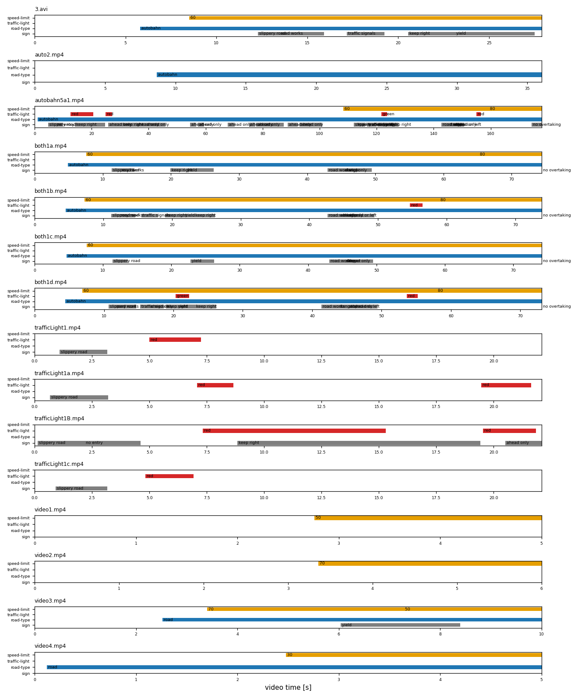
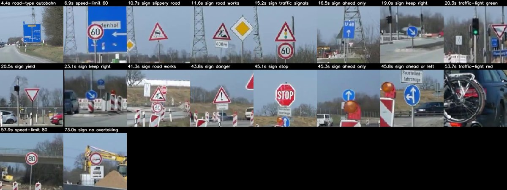
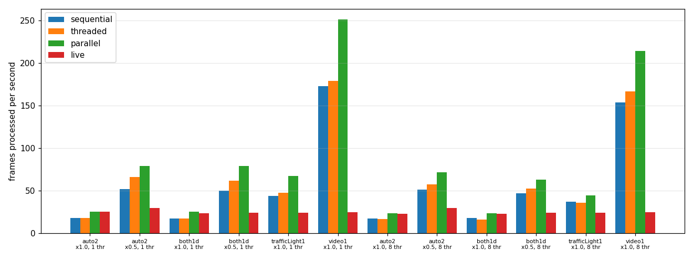

# Results

Everything here is produced by `python scripts/run_experiments.py --bench`
(facts, figures, audit input, benchmark) and `roadsign train` (classifier).
Measured on a laptop: Intel Core i5 (4 cores, 8 threads), Windows 11,
Python 3.10, OpenCV 4.12.

## 1. Sign classifier on GTSRB

HOG + colour histogram, PCA to 400 dimensions, linear SVM, trained on the
39 209 GTSRB training images plus 5 204 background crops.

| | |
|---|---|
| test images | 12 630 (official GTSRB test set) |
| accuracy, 43 classes | **93.9 %** |
| accuracy, speed limits | 91.9 % |
| test signs rejected as background | 0.4 % |
| time per crop | 0.3 ms with feature extraction (SVM alone 0.03 ms) |
| training time | 2 min (feature extraction 6 min, cached) |

Other variants on the same features: no PCA 93.5 % (53 min training),
SGD 92.4 %, PCA 128 + RBF SVM 93.1 % (93.8 % on speed limits, but 5 ms per
crop). The weakest classes are rare ones like "end of no overtaking for
trucks", "end of all limits" and "ice or snow" (69 % to 75 %).
Per class accuracy and the confusion matrix are in
[../models/signs_hog_svm.eval.json](../models/signs_hog_svm.eval.json).

## 2. Facts on the test clips

The 15 clips come from four drives (see [../data/README.md](../data/README.md)).
The classifier's background class uses crops from drives B and D only, so
drives A and C were never seen in training.

### Audit of the asserted facts

For every asserted fact a crop of the detection behind it is saved
([../results/evidence/](../results/evidence/)). I went through these for 11
clips (all four drives) and marked each fact as correct, wrong or unclear:
[../results/audit.csv](../results/audit.csv).

| Fact | Asserted | Correct | Wrong | Unclear |
|---|---|---|---|---|
| speed-limit | 8 | 8 | 0 | 0 |
| road-type | 5 | 5 | 0 | 0 |
| sign | 26 | 23 | 3 | 0 |
| traffic-light | 8 | 3 | 2 | 3 |
| **all** | **47** | **39 (83 %)** | **5** | **3** |

Precision over the facts that could be judged: 39 / 44 = 89 %.

The wrong ones: a blue detour sign and a square blue information sign read as
"ahead only", a poster as "no entry", the tail light of a car and an orange
roof as red traffic lights. The unclear ones are red lights in drive B where
the lamp is only a few pixels and the crop does not show whether there is a
housing. This audit only measures precision; signs and lights that were
never asserted are not counted, and the traffic light detector clearly misses
many lights (most green phases in drive B, small far away lights).

### Same drive at different resolutions

`both1a` to `both1d` are the same 75 s of drive A at four resolutions and
`autobahn5a1` contains the same stretch again from 101 s on. Taking the facts
of `both1d` (1920 x 1080, processed at 960 x 540) as reference:

| Clip | Resolution | Facts | Also in reference | Reference facts found |
|---|---|---|---|---|
| both1b | 1280 x 720 | 16 | 16 (100 %) | 16 / 18 |
| autobahn5a1 | 1920 x 1080 | 17 | 17 (100 %) | 17 / 18 |
| both1a | 720 x 406 | 12 | 8 (67 %) | 8 / 18 |
| both1c | 640 x 360 | 9 | 6 (67 %) | 6 / 18 |

Above 720p the result hardly depends on the resolution. At 640 x 360 most
signs are below 20 pixels and two thirds of the facts are lost. This is the
price of the "resize the frame" speed-up from my 2021 report: it buys frame
rate with missed signs.

## 3. Pipeline modes

600 frames per clip (or the whole clip), all three detectors, facts and CAN
encoding. `x0.5` = Full HD processed at 960 x 540. `8 thr` = OpenCV's own
thread pool, `1 thr` = `cv2.setNumThreads(1)`.

The live mode reads at the video frame rate, so its bar stays at 24 to 30
fps as long as the detectors keep up; what matters there is the dropped
frames and the latency.

| Clip | | sequential | threaded | parallel | live: dropped, latency |
|---|---|---|---|---|---|
| video1 640x360 | 1 thr | 173 fps | 179 | **252** | 0, 11 ms |
| trafficLight1 1280x720 | 1 thr | 44 | 47 | **67** | 0, 16 ms |
| both1d x0.5 | 1 thr | 50 | 62 | **79** | 0, 10 ms |
| both1d x1.0 | 1 thr | 17 | 17 | **25** | 9 / 600, 44 ms |
| auto2 x1.0 (30 fps) | 1 thr | 18 | 18 | **25** | 95 / 600, 53 ms |
| both1d x0.5 | 8 thr | 47 | 53 | **63** | 0, 12 ms |
| both1d x1.0 | 8 thr | 18 | 16 | **23** | 21 / 600, 60 ms |

Full numbers incl. CPU use and time per detector: [../results/bench.csv](../results/bench.csv).

What this shows:

- **Running the detectors on the same frame in parallel is what helps:**
  1.4 to 1.6 times the sequential frame rate. OpenCV releases the GIL, so
  plain threads work.
- **Decoding ahead in a thread helps little here** (up to 1.25 times at
  half size, nothing at Full HD). With three detectors per frame, decoding is
  no longer the bottleneck. In 2021 it was, because the old scripts did much
  less per frame and the frames came from 1080p files.
- **A queue gives throughput, not low latency.** On a recorded file the
  queue fills up and a frame waits seconds before it is processed. For a
  camera the live mode is the right one: latency 8 to 60 ms.
- **Full HD in real time is not possible on this laptop** (25 fps with
  everything, the 30 fps clip drops 16 % of its frames). At 960 x 540 there
  is room for three times the work, and section 2 shows this resolution
  loses nothing.
- **OpenCV's internal threads do not help** when the detectors already run
  in parallel; one OpenCV thread is as fast or faster and uses half the CPU.
  On a Raspberry Pi 3 B (4 slower cores) this is the setting to start with.

### Compared with 2021

My 2021 report measured the old traffic sign / light script on the 75 s
clip at 151.8 s without and 96 s with threads (11.9 and 18.7 frames per
second, but with frames skipped in the threaded run). The new pipeline does
traffic lights, all GTSRB signs and direction signs on the same 1800 frames
in 25 s at 960 x 540 (73 fps) or 77 s at full resolution, without skipping a
frame. These are different algorithms, so this is not a like-for-like
speed-up of the old code.

## 4. CAN

Every fact change is one 8 byte frame. Over all 15 clips the run sent 212
CAN frames (118 asserts, 94 retracts), i.e. a few frames per second at most, far below what a 500
kbit/s CAN bus carries. The candump logs are in
[../results/facts/](../results/facts/) and decode back to the same fact set
(checked by the receiving side in every run and in the tests).
